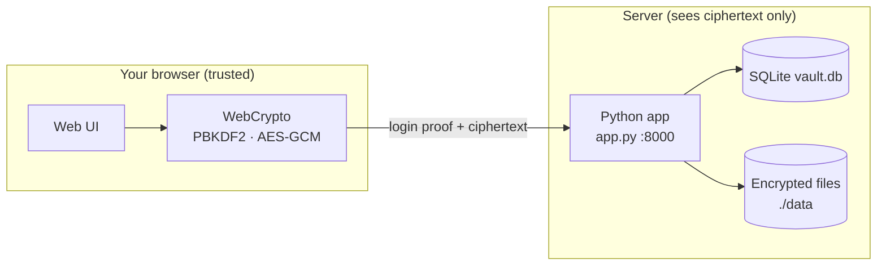
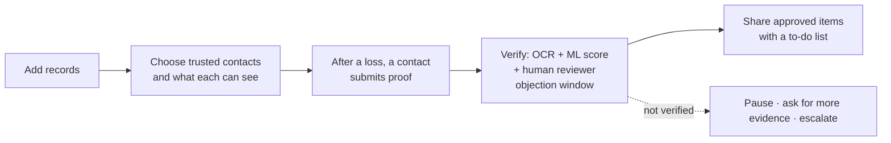

# 🛡️ Digital Inheritance Vault

### Find it. Protect it. Pass it on.


## Table of contents

- [The problem](#the-problem)
- [The solution](#the-solution)
- [Screenshots](#screenshots)
- [Features: built vs planned](#features-built-vs-planned)
- [Quick start](#quick-start)
- [How the encryption works](#how-the-encryption-works)
- [Architecture](#architecture)
- [Tech stack](#tech-stack)
- [Security model and honest limits](#security-model-and-honest-limits)
- [Roadmap](#roadmap)
- [How it compares](#how-it-compares)
- [Research and references](#research-and-references)
- [About this project](#about-this-project)

---

## The problem

A father passes away. His family finds an old insurance receipt, but no policy number, no login and no list of other accounts. They are grieving and searching at the same time.

| What goes wrong | Why it hurts |
|---|---|
| 💸 **Money is missed** | Bank accounts, investments or insurance stay unknown. |
| 🔒 **Access is blocked** | Passwords and privacy checks stop family members. |
| 🔁 **Bills continue** | Subscriptions and recurring payments keep charging. |
| 📷 **Memories are lost** | Photos, emails and files become inaccessible. |

In India alone, deposits worth **Rs 35,012 crore** sit unclaimed, which is why the RBI built the UDGAM portal [[4]](#research-and-references).

## The solution

**Digital Inheritance Vault** is a private, encrypted place to record what you own and who should be able to find it. It is built around one rule: **the server never sees your data.**

- **Locked data:** records and files are encrypted in your browser before upload.
- **Per-person access:** each trusted contact is meant to see only their own items.
- **Proof before access:** the planned claim flow checks identity and proof first.
- **Inactivity is never proof:** a missed check-in is only a warning. It never unlocks the vault.

## Screenshots

| Vault dashboard | Add a record |
|:---:|:---:|
|  |  |
| 8 record categories, live counters and an encryption badge | Category-specific forms, trusted contact and drag-and-drop uploads |

## Features: built vs planned

### ✅ Working in the prototype

- **Accounts:** create a vault and sign in. Each user has their own account, and records are saved and available at every sign-in.
- **8 record categories:** bank, insurance, investments, online accounts, property, legal papers, memories, other. Each has its own basic-details form.
- **Trusted-contact field** on every record.
- **Document upload:** drag and drop, up to 15 MB per file.
- **View, preview, download, edit and delete** records (previews for images and PDFs).
- **Activity log** of every sign-in, failed attempt, upload and file access.
- **Zero-knowledge encryption** in the browser (details [below](#how-the-encryption-works)).
- **Idle lock:** the key is dropped after 15 minutes of inactivity or on sign-out.

### 🚧 Designed, not yet built

- Trusted-contact **claim flow** with an objection window
- **Shamir shared key**, so no single person can open the vault alone
- **Proof verification** with OCR (Tesseract) and ML scoring (scikit-learn), always followed by a human reviewer
- **LLM claim guide**: a plain-language to-do list for the family
- **MFA**
- **TLS** (required before any real use)
- Regional-language help and India-aware paperwork

## Quick start

```bash
# 1. Install dependencies
pip install -r requirements.txt

# 2. Run the app
python app.py

# 3. Open it in your browser
#    http://localhost:8000
```

> **Use `http://localhost` or `https://`.** Browser encryption (WebCrypto) needs a secure context, so it will not work from a plain `http://` address on another machine.

**Where data lives:** everything is stored in `./data` (`vault.db` plus encrypted files). Delete that folder to reset the app.

## How the encryption works

The prototype is **zero-knowledge**: encryption and decryption happen only in your browser.

```
 Password
    │  PBKDF2-SHA256, 600,000 rounds (in the browser)
    ▼
 512 bits
    ├── first 256 bits ──► login proof ──► sent to server (server stores only a scrypt hash)
    └── last 256 bits  ──► wrap key   ──► never leaves the device
                                │
 Random AES-256 master key ─────┘  wrapped with AES-GCM and stored
    │
    ▼
 Record details, file names, categories and file bytes
 encrypted with AES-256-GCM (fresh random IV every time) BEFORE upload
```

1. Your password goes through **PBKDF2-SHA256** (600,000 rounds), producing 512 bits.
2. The **first 256 bits** are the login proof. The server stores only a **scrypt hash** of it.
3. The **last 256 bits** are a wrap key. It is never sent anywhere.
4. A random **AES-256 master key** is created at sign-up, wrapped with **AES-GCM** using the wrap key, and stored.
5. Record details, file names, categories and file bytes are encrypted with **AES-256-GCM** (a fresh random IV each time) *before* upload. The server and database hold only ciphertext.
6. The decrypted master key lives only in browser memory (non-extractable) and is dropped on sign-out or after 15 minutes idle.

## Architecture



**Planned claim flow** (not yet implemented):



## Tech stack

| Layer | Prototype today | Planned for production |
|---|---|---|
| **Frontend** | Web UI using browser WebCrypto | React, mobile-friendly web app |
| **Backend** | Python app (`app.py`) on port 8000 | FastAPI with role-based access and claim workflow |
| **Data** | SQLite (`vault.db`) plus encrypted files in `./data` | PostgreSQL, encrypted records and files, TLS in transit |
| **AI tools** | none yet | Tesseract OCR, scikit-learn scoring, LLM claim guide |
| **Security** | AES-256-GCM, PBKDF2-SHA256, scrypt, activity log, idle lock | AES-256, MFA, Shamir shared key, audit log, proof-first checks |

## Security model and honest limits

This is a **hackathon prototype**, not a finished product. Please read these before trusting it with anything real.

- 🔑 **No password recovery.** Forget the password and the data is lost. That is the price of real encryption.
- 🚫 **Not built yet:** the claim flow, Shamir shared key, proof verification (OCR/ML), MFA and TLS. Put the app behind **HTTPS** before any real use.
- 👁️ **The server can still see metadata:** your email, the number and size of items and files, and timestamps.
- 🧪 **Not audited.** The cryptography uses standard browser primitives, but the project has had no independent security review.

**Design principles for the planned flow:** proof before access, no single point of trust, a human makes the final call, and an ML score only *guides* the reviewer. It never unlocks the vault on its own.

## Roadmap

| Phase | Focus | Status |
|---|---|---|
| **1. Prototype** | Asset inventory, encrypted storage, trusted contacts and permissions | 🟢 Working prototype |
| **2. Safety flow** | Manual verification, objection window, audit logs and export | ⚪ Planned |
| **3. Pilot test** | Test with users and professionals; security review | ⚪ Planned |
| **4. Integrate** | Institution workflows (banks, insurers) and more local languages | ⚪ Planned |

## How it compares

| | Google | Apple | Bitwarden | Everplans | **This vault** |
|---|:---:|:---:|:---:|:---:|:---:|
| Covers many asset types | Partial | Partial | Partial | Yes | **Yes** |
| Different access per person | Yes | — | Partial | Yes | **Yes** |
| Proof checked before access | Partial | Yes | Partial | — | **Yes** *(planned)* |
| Step-by-step claim guidance | No | No | No | Partial | **Yes** *(planned)* |
| Main limit | Google data only | Apple data only | Premium; needs account | US-focused | Prototype stage |

Competitor details come from public help pages, accessed October 2026. None of the options we reviewed combines **discovery, proof checks and guided claims**. That is the gap this project targets.

## Research and references

1. Öhman, C. & Floridi, L. (2017). Research on the digital afterlife, showing why digital remains need care. https://doi.org/10.1007/s11023-017-9445-2
2. Shamir, A. (1979). *How to share a secret.* The basis for splitting a key among people so none can open it alone. https://doi.org/10.1145/359168.359176
3. Government of India, **Digital Personal Data Protection Act, 2023**, Section 14: people may name a nominee.
4. Business Standard (2023). *RBI launches UDGAM, a centralised web portal for unclaimed deposits.* Source of the Rs 35,012 crore figure.

## About this project

Built **solo** for the **PROMPTWARS × AGENTX 2.0** hackathon.

Everyone leaves a digital footprint. This project helps make sure the right people can find it.

---


**Find it. Protect it. Pass it on.**

</div>
